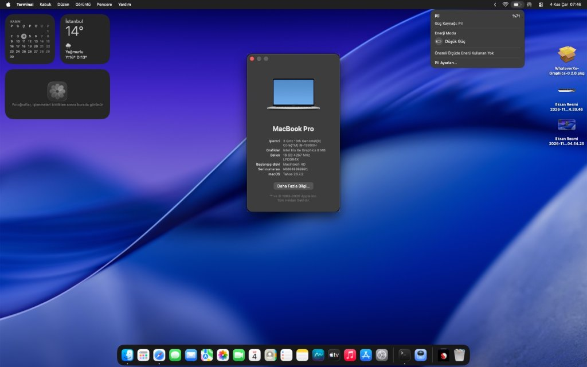

# 🍎 Huawei MateBook D 16 (2023/2024) Hackintosh Guide

<p align="center">
  
</p>

<p align="center">
  <a href="README_TR.md"></a>
  
  
  
  
</p>

---

> 📖 **Language Selection:**
> - 🇬🇧 **English:** [README.md](README.md) *(You are here)*
> - 🇹🇷 **Türkçe:** [README_TR.md](README_TR.md)

---

## 💻 Hardware Specifications

| Component | Technical Details | macOS Status | Notes |
| :--- | :--- | :---: | :--- |
| **Model** | Huawei MateBook D 16 (2023 / 2024, MCLG-XX) | 🟢 | Full UEFI OpenCore setup |
| **CPU** | 13th Gen Intel® Core™ i9-13900H (14C / 20T: 6P + 8E) | 🟢 **Working** | Full heterogenous scheduling via `CpuTopologyRebuild.kext` |
| **iGPU** | Intel® Iris® Xe Graphics 96EU (`8086:A7A0`) | 🟡 **Framebuffer** | 1920x1200 native resolution; 3D/Metal acceleration awaiting upcoming WhateverXe ADLP release |
| **RAM** | 16 GB LPDDR4X 4267 MHz (Dual Channel) | 🟢 **Working** | Fully recognized & stable |
| **Storage** | 1 TB M.2 PCIe 4.0 NVMe SSD | 🟢 **Working** | Native APFS support via `NVMeFix.kext` |
| **Wi-Fi** | Intel® Wi-Fi 6 AX201 160MHz (`8086:51F1`) | 🟢 **Working** | Native Airport interface via `AirportItlwm.kext` |
| **Bluetooth** | Intel® Wireless Bluetooth (`8087:0026`) | 🟡 **WIP / Issue** | Detected via `IntelBluetoothFirmware` + `BlueToolFixup`, but switch toggles off after enabling; fix in progress |
| **Battery** | 70,000 mWh ACPI Battery (`ACPI\PNP0C0A`) | 🟢 **Working** | Percentage & charging status functional with `ECEnabler.kext` |
| **Keyboard** | Internal PS/2 Keyboard & Backlight | 🟢 **Working** | `VoodooPS2Controller.kext` |
| **Brightness Keys** | F1 / F2 Function Keys | 🟢 **Working** | Out-of-the-box support with `BrightnessKeys.kext` |
| **Trackpad** | FocalTech FTCS1000 I2C Precision Trackpad | 🟡 **WIP / Active** | Bridge injected via custom `SSDT-TPD0.aml` under `_SB.PC00.I2C0` |
| **Audio** | Conexant CX8200 / SN6140 (`14F1:1F87`) on Intel cAVS (`8086:51CA`) | 🟡 **Testing** | AppleALC Layout-ID configuration in progress |
| **Ports** | USB-C (Data & Power Delivery), USB 3.2 Gen 1, USB 2.0, HDMI | 🟢 **Working** | Mapped via `USBToolBox.kext` + `UTBDefault.kext` |

---

## 🎯 Current Status & Key Highlights

### ⚡ What's Working:
- ✅ **13th Gen Core i9 Hybrid Architecture:** All 6 Performance Cores and 8 Efficiency Cores (20 threads) correctly scheduled with `CpuTopologyRebuild.kext`.
- ✅ **CPU Name & Brand String:** Correctly displays `3 GHz 13th Gen Intel(R) Core(TM) i9-13900H` in *About This Mac* via `RestrictEvents.kext` (`revcpu=1`, `revcpuname`).
- ✅ **Battery Management:** Correctly monitors battery life and AC charging state with `ECEnabler.kext`.
- ✅ **Intel Wi-Fi 6 AX201:** High-speed wireless connectivity and native macOS Wi-Fi menu bar status via `AirportItlwm.kext`.
- ✅ **NVMe PCIe Gen 4 Storage:** High-speed read/write performance with `NVMeFix.kext`.
- ✅ **Display Output:** Sharp native 1920x1200 @ 60Hz display output with functional brightness control.
- ✅ **Dual-Boot Windows 11 + macOS:** Independent boot with native UEFI entries, isolated EFI structures.

### 🟡 Work In Progress / Known Limitations:
- **Intel Iris Xe Hardware Acceleration:**
  - Standard VESA/Basic Framebuffer runs cleanly with smooth UI rendering at native resolution.
  - WhateverXe 0.7.0 officially enables Tiger Lake (TGL). Our binary reverse engineering experiments confirmed that Metal 3D hooks load, but Alder Lake-P / Raptor Lake-H internal panel modeset registers require the upcoming upstream WhateverXe release.
  - *No action needed from your side; official WhateverXe updates will drop right in!*
- **FocalTech FTCS1000 Touchpad:**
  - Huawei's factory DSDT misplaces `TPD0` directly under `\_SB.PC00` instead of the standard I2C host controller (`\_SB.PC00.I2C0`).
  - We engineered a dedicated ACPI bridge (`SSDT-TPD0.aml`) and disabled the original table device with `_STA -> XSTA` patch. Ongoing tuning in upcoming commits.
- **Internal Speakers / Microphone:**
  - Conexant CX8200 codec layout-ids (e.g. 3, 11, 21, 28) currently being verified with `AppleALC.kext`.
- **Bluetooth Toggling Off:**
  - Intel Bluetooth controller (`8087:0026`) is detected by `IntelBluetoothFirmware.kext` and `BlueToolFixup.kext`.
  - However, when attempting to turn Bluetooth on from the Control Center or System Settings, it momentarily switches on and immediately reverts back to off.
  - This is a known firmware handshake/USB internal port mapping timing behavior in modern macOS releases and is queued for resolution in upcoming commits.

---

## 🔧 BIOS Settings

Before booting OpenCore, configure your Huawei BIOS:

| Setting | Value | Why |
| :--- | :--- | :--- |
| **Secure Boot** | **Disabled** | Required to load OpenCore unsigned drivers |
| **Fast Boot** | **Disabled** | Ensures ACPI controllers initialize completely |
| **Intel Virtualization (VT-x)** | **Enabled** | Required for hypervisor & macOS core tasks |
| **Intel VT-d** | **Enabled** | Supported with `DisableIoMapper = False` or ACPI mapping |
| **SATA / NVMe Mode** | **AHCI / NVMe** | Ensure no Intel RST RAID lock is enabled |

---

## 🚀 Installation Guide

### 1. Preparing the USB Installer
1. Create a bootable macOS USB installer using **macrecovery** or **gibMacOS** (macOS Sonoma 14.x, macOS Sequoia 15.x, or macOS Tahoe).
2. Format the USB drive with `GPT` (GUID Partition Table) and `FAT32` or `Mac OS Extended (Journaled)`.

### 2. Installing the EFI
1. Download or clone this repository:
   ```bash
   git clone https://github.com/akiffurkan/Huawei-MateBook-D16-Hackintosh-Guide.git
   ```
2. Copy the `EFI` folder from this repository directly to the root of your USB drive's EFI partition.

### 3. Generating Your Own Serial Numbers (Important!)
> [!IMPORTANT]
> The included `config.plist` is pre-sanitized with dummy serial numbers (`C02XXXXXXXXX`) to protect user privacy. You **must** generate your own credentials before signing into Apple ID / iCloud:

1. Download [GenSMBIOS](https://github.com/corpnewt/GenSMBIOS).
2. Run GenSMBIOS and select option `3` (Generate SMBIOS).
3. Enter model identifier: `MacBookPro16,1` (or `MacBookPro16,4`).
4. Paste the generated `Type`, `Serial`, `Board Serial (MLB)`, and `SmUUID` into `EFI/OC/config.plist` under:
   `PlatformInfo -> Generic`.

### 4. Booting & Setup
1. Insert the USB into the USB-A or USB-C port.
2. Turn on your laptop while tapping **F12** to open the Boot Menu.
3. Select the OpenCore UEFI boot entry.
4. In the OpenCore menu, always choose **Reset NVRAM** on your first boot!
5. Select **Install macOS** and proceed with formatting your target NVMe APFS partition.

---

## 💡 Pro-Tips & Technical Notes

### Why Does "About This Mac" Show 3.00 GHz instead of 5.40 GHz?
macOS displays the processor's **Base Clock (Temel Saat Hızı)**, which is exactly **3.00 GHz** for the Core i9-13900H. In real MacBooks, Apple displays the base speed (e.g., 2.4 GHz Core i9), but on active load, Intel Speed Shift and `CpuTopologyRebuild` automatically boost your P-cores up to the full **5.40 GHz** turbo ceiling!

### Battery Calibration Note (70,000 mWh)
Because Apple MacBook Pro batteries are configured for ~60,000 mAh, the battery meter may show 100% until the actual charge drops below 60,000 mAh. Once past this threshold, the percentage and drainage rate reflect real-time usage accurately.

---

## 🗺️ Roadmap & Upcoming Commits

- [x] Full CPU hybrid core management (`CpuTopologyRebuild`)
- [x] OpenCore 1.0.4+ UEFI configuration & ACPI hotpatches
- [x] Cosmetic CPU name enabler (`RestrictEvents` + `revcpu`)
- [x] Battery status indicator (`ECEnabler`)
- [x] Custom ACPI bridge for FocalTech Touchpad (`SSDT-TPD0.aml`)
- [ ] Finalize FocalTech FTCS1000 GPIO interrupt pin routing
- [ ] Determine optimum Conexant CX8200 AppleALC Layout-ID
- [ ] Drop-in WhateverXe update once native Alder Lake / Raptor Lake graphics acceleration is released upstream

---

## 🤝 Contributing

Contributions, issues, and pull requests are welcome! If you have the same Huawei MateBook D 16 model and have tested specific layout-ids or ACPI fixes, please open an Issue or PR.

---

## 📜 Credits & Acknowledgements

- [Acidanthera](https://github.com/acidanthera) for OpenCore, Lilu, VirtualSMC, AppleALC, RestrictEvents, and VoodooPS2.
- [Alexandred](https://github.com/VoodooI2C/VoodooI2C) for VoodooI2C and VoodooI2CHID.
- [b00t0x](https://github.com/b00t0x) for `CpuTopologyRebuild`.
- [1Revenger1](https://github.com/1Revenger1) & [ChefKissInc](https://github.com/ChefKissInc) for `ECEnabler` and `NootedRed` / `WhateverXe`.
- [OpenIntelWireless](https://github.com/OpenIntelWireless) for `AirportItlwm` and `IntelBluetoothFirmware`.

---

<p align="center">
  Crafted with ❤️ by <a href="https://github.com/akiffurkan">Akif Furkan EMİR</a>
</p>
