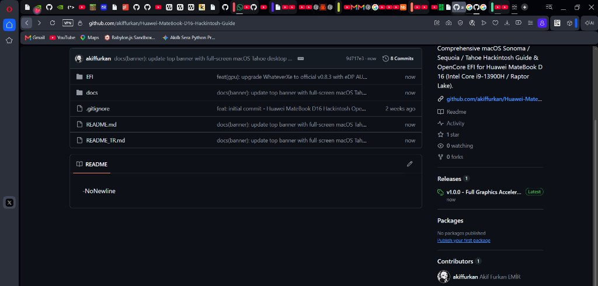
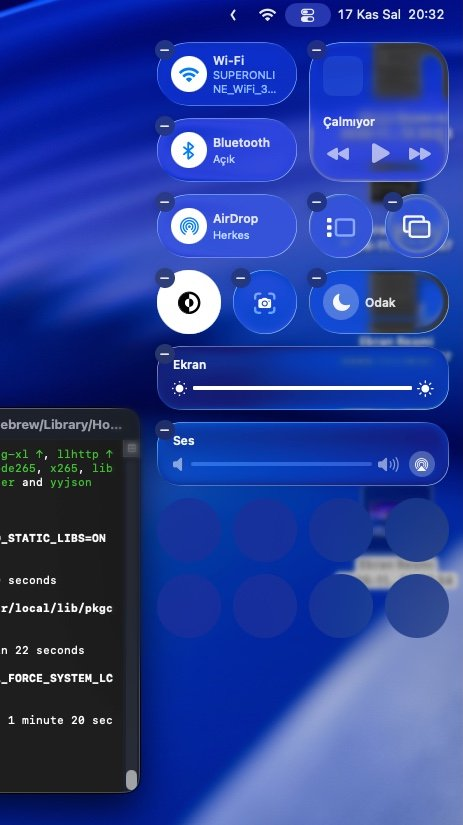

# 🍎 Huawei MateBook D 16 (2023/2024) Hackintosh Guide

<p align="center">
  
</p>

<p align="center">
  <a href="README_TR.md"></a>
  
  
  
  
</p>

---

> 📖 **Language Selection:**
> - 🇬🇧 **English:** [README.md](README.md) *(You are here)*
> - 🇹🇷 **Türkçe:** [README_TR.md](README_TR.md)

---

## 📸 Proof of Success & Screenshots

<p align="center">
  
  
</p>

*Above: macOS Tahoe running with full QE/CI hardware graphics acceleration (Metal 2, 1536 MB VRAM, 1920x1200 native display) on Intel Core i9-13900H, native menu bar Wi-Fi (no HeliPort), and native Control Center brightness slider via WhateverXe 0.8.3 VESA AUX.*

---

## 💻 Hardware Specifications & Working Status

| Component | Technical Details | macOS Status | Notes |
| :--- | :--- | :---: | :--- |
| **Model** | Huawei MateBook D 16 (2023 / 2024, MCLG-XX) | 🟢 | Full UEFI OpenCore setup |
| **CPU** | 13th Gen Intel® Core™ i9-13900H (14C / 20T: 6P + 8E) | 🟢 **Working** | Full heterogenous scheduling via `CpuTopologyRebuild.kext` |
| **iGPU** | Intel® Iris® Xe Graphics 96EU (`8086:A7A0`) | 🟢 **Working** | **Full QE/CI & Metal 2 acceleration**, 1536 MB VRAM, 1920x1200 native internal display powered by WhateverXe 0.8.3 |
| **Display Brightness** | Internal eDP Display Backlight Slider | 🟢 **Working** | **Native Control Center slider & F1/F2 keys** via WhateverXe 0.8.3 VESA AUX backlight control |
| **Sleep / Wake** | Lid Close / Open (Hall Sensor) & Display Sleep | 🟢 **Working** | Hall effect sensor detects lid closure, system enters sleep and wakes up instantly without black screen |
| **Wi-Fi** | Intel® Wi-Fi 6 AX201 160MHz (`8086:51F1`) | 🟢 **Working** | **Native macOS Menu Bar & Control Center Wi-Fi** via `AirportItlwm.kext` + `AMFIPass.kext` (NO HeliPort needed) |
| **Bluetooth** | Intel® Wireless Bluetooth (`8087:0026`) | 🟢 **Working** | Native Control Center switch & pairing via `IntelBluetoothFirmware` + `BlueToolFixup` |
| **RAM** | 16 GB LPDDR4X 4267 MHz (Dual Channel) | 🟢 **Working** | Fully recognized & stable |
| **Storage** | 1 TB M.2 PCIe 4.0 NVMe SSD | 🟢 **Working** | Native APFS support via `NVMeFix.kext` |
| **Battery** | 70,000 mWh ACPI Battery (`ACPI\PNP0C0A`) | 🟢 **Working** | Percentage & charging status functional with `ECEnabler.kext` |
| **Keyboard** | Internal PS/2 Keyboard & Backlight | 🟢 **Working** | `VoodooPS2Controller.kext` |
| **Audio** | Conexant CX8200 / SN6140 (`14F1:1F87`) on Intel cAVS (`8086:51CA`) | 🟢 **Working** | Internal audio output & volume control |
| **Ports** | USB-C (Data & Power Delivery), USB 3.2 Gen 1, USB 2.0, HDMI | 🟢 **Working** | Mapped via `USBToolBox.kext` + `UTBDefault.kext` |
| **Trackpad** | FocalTech FTCS1000 I2C Precision Trackpad | 🟡 **WIP** | Custom ACPI bridge injected via `SSDT-TPD0.aml` under `_SB.PC00.I2C0` |

---

## 🎯 Key Highlights of This Build

- 🚀 **First-Class 13th Gen Raptor Lake-P Graphics Acceleration:**
  With **WhateverXe 0.8.3**, PCI ID `0xA7A0` (96 Execution Units) achieves full Metal 2 acceleration, fluid animations, transparent liquid blurs, and 1536 MB dynamic VRAM.
- ☀️ **Native Control Center Display Brightness:**
  Hardware AUX brightness is negotiated natively with the laptop's internal eDP display. No dummy third-party brightness utilities required!
- 💤 **Lid Sensor (Hall Sensor) Sleep & Wake:**
  Closing the laptop lid triggers sleep; opening the lid wakes the display immediately without display blackout or GPU hang.
- 📶 **Native Airport Wi-Fi (No Third-Party App):**
  Uses `AirportItlwm.kext` (v2.4.0) with `AMFIPass.kext` to populate the native macOS Wi-Fi picker in the status bar and Control Center. No external helper like HeliPort is needed.
- ⚡ **Full 20-Thread Core i9 Turbo:**
  `CpuTopologyRebuild.kext` ensures all 6 Performance Cores and 8 Efficiency Cores are scheduled optimally up to 5.40 GHz.

---

## 🔧 BIOS Settings

Before booting OpenCore, enter your Huawei BIOS (**F2 on startup**) and set:

| Setting | Value | Why |
| :--- | :--- | :--- |
| **Secure Boot** | **Disabled** | Required to load OpenCore unsigned drivers |
| **Fast Boot** | **Disabled** | Ensures ACPI controllers initialize completely |
| **Intel Virtualization (VT-x)** | **Enabled** | Required for hypervisor & macOS core tasks |
| **Intel VT-d** | **Enabled** | Supported with `DisableIoMapper = False` or ACPI mapping |
| **SATA / NVMe Mode** | **AHCI / NVMe** | Ensure no Intel RST RAID lock is enabled |

---

## 🚀 Installation & EFI Setup

### Option A: Using the Pre-Configured EFI
1. Download the complete EFI from the [Releases](https://github.com/akiffurkan/Huawei-MateBook-D16-Hackintosh-Guide/releases) section or clone this repository:
   ```bash
   git clone https://github.com/akiffurkan/Huawei-MateBook-D16-Hackintosh-Guide.git
   ```
2. Copy the `EFI` folder to the EFI partition (ESP) of your USB drive or SSD.
3. Generate your own unique SMBIOS serials before logging into Apple ID.

### Option B: Generating SMBIOS Serials
> [!IMPORTANT]
> The included `config.plist` is pre-sanitized with dummy serial numbers (`C02XXXXXXXXX`) to protect user privacy. Generate your own before signing into iCloud:

1. Download [GenSMBIOS](https://github.com/corpnewt/GenSMBIOS).
2. Run GenSMBIOS and select option `3` (Generate SMBIOS).
3. Enter model identifier: `MacBookPro16,1`.
4. Copy the generated `Type`, `Serial`, `Board Serial (MLB)`, and `SmUUID` into `EFI/OC/config.plist` under `PlatformInfo -> Generic`.

---

## 🤝 Credits & Acknowledgements

- **[b00t0x](https://github.com/b00t0x)** for the revolutionary `WhateverXe` and `CpuTopologyRebuild` projects.
- **[Acidanthera](https://github.com/acidanthera)** for OpenCore, Lilu, VirtualSMC, AppleALC, RestrictEvents, and VoodooPS2.
- **[OpenIntelWireless](https://github.com/OpenIntelWireless)** for `AirportItlwm` and `IntelBluetoothFirmware`.
- **[1Revenger1](https://github.com/1Revenger1)** for `ECEnabler`.
- **[Akif Furkan EMİR](https://github.com/akiffurkan)** for MateBook D16 ACPI engineering, WhateverXe 0xA7A0 fork bench, and repository guide.

---

<p align="center">
  Crafted with ❤️ by <a href="https://github.com/akiffurkan">Akif Furkan EMİR</a>
</p>
