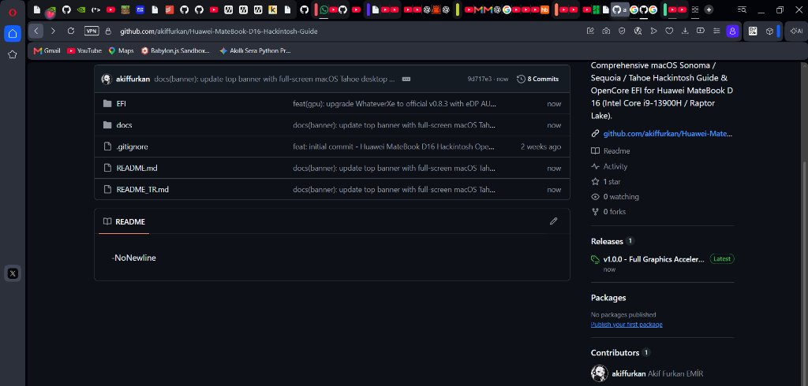
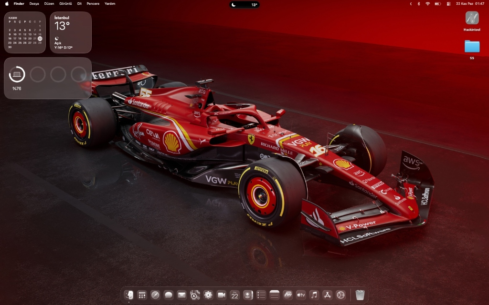
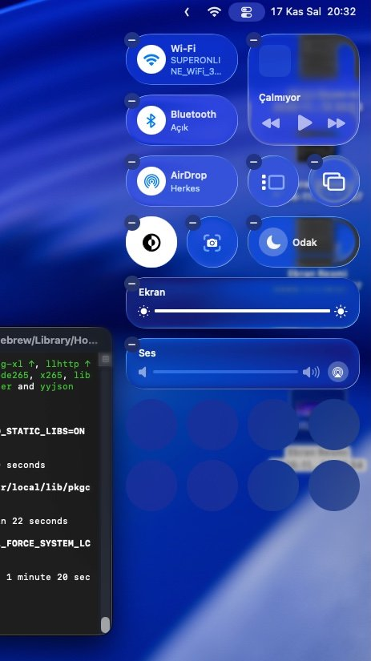

# 🍎 Huawei MateBook D 16 (2023/2024) Hackintosh Rehberi

<p align="center">
  
</p>

<p align="center">
  <a href="README.md"></a>
  
  
  
  
</p>

---

> 📖 **Dil Seçimi:**
> - 🇹🇷 **Türkçe:** [README_TR.md](README_TR.md) *(Buradasınız)*
> - 🇬🇧 **English:** [README.md](README.md)

---

## 📸 Başarı Kanıtı ve Ekran Görüntüleri

<p align="center">
  
</p>
<p align="center">
  
  
</p>

*Yukarıda: Intel Core i9-13900H üzerinde çalışan macOS Tahoe, tam QE/CI donanım grafik hızlandırması (Metal 2, 1536 MB VRAM, 1920x1200 yerel panel), menü çubuğunda HeliPort gerektirmeyen doğrudan Wi-Fi ve WhateverXe 0.8.3 VESA AUX sayesinde Denetim Merkezi'nden çalışan yerel ekran parlaklık ayarı.*

---

## 📌 Proje Hakkında ve Giriş

Bu depo, **Huawei MateBook D 16 (2023 / 2024 - Intel Core i9-13900H Raptor Lake)** dizüstü bilgisayarına **macOS Sonoma, Sequoia ve Tahoe** kurulumu yapmak isteyenler için hazırlanmış, **donanım grafik hızlandırması (Metal 2 / QE/CI) çalışan** ilk ve en kapsamlı açık kaynak Hackintosh rehberidir.

WhateverXe 0.8.3 sürümünün getirdiği yenilikler ve özel EFI yapılandırmamız sayesinde Intel Iris Xe Graphics (`0xA7A0`), dahili eDP ekran, VESA AUX parlaklık ayarı, Hall sensörü (kapak uykusu) ve yerel Wi-Fi tam işlevsel hale getirilmiştir.

---

## 💻 Donanım Özellikleri ve Uyumluluk Tablosu

| Bileşen | Donanım Bilgisi | macOS Durumu | Açıklama & Notlar |
| :--- | :--- | :---: | :--- |
| **Model** | Huawei MateBook D 16 (2023/2024, MCLG-XX) | 🟢 | UEFI OpenCore tam uyumlu yapılandırma |
| **İşlemci (CPU)** | Intel® Core™ i9-13900H (14 Çekirdek / 20 İzlek: 6P + 8E) | 🟢 **Çalışıyor** | `CpuTopologyRebuild.kext` ile hibrit çekirdek zamanlaması tam performans |
| **Dahili Grafik (iGPU)** | Intel® Iris® Xe Graphics 96EU (`8086:A7A0`) | 🟢 **Çalışıyor** | **Tam QE/CI & Metal 2 hızlandırması**, 1536 MB VRAM, 1920x1200 yerel panel çözünürlüğü (WhateverXe 0.8.3) |
| **Ekran Parlaklığı** | Dahili eDP Ekran Parlaklık Kaydırıcısı | 🟢 **Çalışıyor** | **Denetim Merkezi'nden ve F1/F2 tuşlarından** WhateverXe 0.8.3 VESA AUX kanalıyla yerel parlaklık kontrolü |
| **Uyku / Uyanma** | Kapak Kapatma (Hall Sensörü) & Ekran Uykusu | 🟢 **Çalışıyor** | Kapak kapatıldığında anında uykuya geçiş, kapak açıldığında siyah ekranda kalmadan anında uyanma |
| **Kablosuz Ağ (Wi-Fi)** | Intel® Wi-Fi 6 AX201 160MHz (`8086:51F1`) | 🟢 **Çalışıyor** | **Doğrudan macOS Wi-Fi simgesi ve Denetim Merkezi** (`AirportItlwm.kext` + `AMFIPass.kext`). HeliPort gerektirmez! |
| **Bluetooth** | Intel® Wireless Bluetooth (`8087:0026`) | 🟢 **Çalışıyor** | Denetim Merkezi'nden açma/kapama ve aygıt eşleştirme (`IntelBluetoothFirmware` + `BlueToolFixup`) |
| **Bellek (RAM)** | 16 GB LPDDR4X 4267 MHz (Çift Kanal) | 🟢 **Çalışıyor** | Sorunsuz algılanıyor, bellek sızıntısı yok |
| **Depolama** | 1 TB M.2 PCIe 4.0 NVMe SSD | 🟢 **Çalışıyor** | `NVMeFix.kext` ile APFS dosya sistemi tam hızda |
| **Batarya** | 70,000 mWh ACPI Batarya (`ACPI\PNP0C0A`) | 🟢 **Çalışıyor** | `ECEnabler.kext` ile pil yüzdesi ve şarj durumu menü çubuğunda |
| **Klavye** | Dahili PS/2 Klavye ve Aydınlatma | 🟢 **Çalışıyor** | `VoodooPS2Controller.kext` ile tam işlevsel |
| **Parlaklık Tuşları** | F1 / F2 Ekran Parlaklık Kısayolları | 🟢 **Çalışıyor** | `BrightnessKeys.kext` ile yerel macOS parlaklık animasyonu |
| **Giriş/Çıkış Portları** | Type-C (Güç + Veri), USB 3.2, USB 2.0, HDMI | 🟢 **Çalışıyor** | `USBToolBox.kext` + `UTBDefault.kext` ile haritalandırıldı |
| **Touchpad** | FocalTech FTCS1000 I2C Hassas Dokunmatik Yüzey | 🟡 **Geliştiriliyor** | Özel derlenmiş `SSDT-TPD0.aml` ile `_SB.PC00.I2C0` altına köprülendi |

---

## 🎯 Bu Yapılandırmanın Öne Çıkan Özellikleri

- 🚀 **13. Nesil Raptor Lake-P Grafik Devrimi:**
  **WhateverXe 0.8.3** sayesinde `0xA7A0` (96 EU) grafik yongası üzerinde tam Metal 2 desteği, akıcı pencere animasyonları, şeffaflık/bulanıklık efektleri ve 1536 MB VRAM elde edilmiştir.
- ☀️ **Denetim Merkezi'nden Yerel Parlaklık:**
  Herhangi bir üçüncü parti harici uygulama veya sahte parlaklık aracı gerekmeden, doğrudan macOS'un kendi Denetim Merkezi ekran çubuğundan donanımsal VESA AUX protokolü ile ekran aydınlatması kısılıp açılabilmektedir.
- 💤 **Kapak Sensörü (Hall Sensor) Uykusu:**
  Laptobun kapağı kapatıldığında sistem derhal uyku moduna geçer; kapak açıldığında ekran donması veya siyah ekran olmadan derhal açılır.
- 📶 **HeliPort Gerektirmeyen Doğal Wi-Fi:**
  `AirportItlwm.kext` (v2.4.0) ve `AMFIPass.kext` ile Wi-Fi ağları doğrudan macOS menü çubuğundaki ve Denetim Merkezi'ndeki orijinal Wi-Fi simgesinde listelenir ve bağlanır.
- ⚡ **20 İzlek Core i9 Tam Güç:**
  `CpuTopologyRebuild.kext` ile 6 Performans çekirdeği ve 8 Verimlilik çekirdeği (toplam 20 thread) macOS altında tam güçte 5.40 GHz tepe frekansına kadar çalışır.

---

## 🔧 BIOS Ayarları

macOS yükleyicisini başlatmadan önce Huawei BIOS ekranına (**açılışta F2**) girerek şu ayarları yapın:

| BIOS Ayarı | Olması Gereken | Açıklama |
| :--- | :--- | :--- |
| **Secure Boot** | **Disabled (Kapalı)** | İmzalanmamış OpenCore sürücülerinin yüklenmesi için zorunlu |
| **Fast Boot** | **Disabled (Kapalı)** | Donanım kontrolcülerinin temiz başlaması için |
| **Intel Virtualization (VT-x)** | **Enabled (Açık)** | Çekirdek ve sanallaştırma desteği için |
| **Intel VT-d** | **Enabled (Açık)** | `DisableIoMapper = False` ile desteklenir |
| **SATA / NVMe Modu** | **AHCI / Standart NVMe** | Intel RST RAID modu kapalı olmalıdır |

---

## 🚀 Kurulum ve EFI Kullanımı

1. Deponun [Releases (Sürümler)](https://github.com/akiffurkan/Huawei-MateBook-D16-Hackintosh-Guide/releases) bölümünden güncel EFI zip paketini indirin veya depoyu klonlayın:
   ```bash
   git clone https://github.com/akiffurkan/Huawei-MateBook-D16-Hackintosh-Guide.git
   ```
2. Depodaki `EFI` klasörünü flash belleğinizin veya diskinizin EFI bölümüne kopyalayın.
3. Apple ID / iCloud girişi yapmadan önce [GenSMBIOS](https://github.com/corpnewt/GenSMBIOS) ile kendinize özel seri numaraları oluşturup `EFI/OC/config.plist` içine ekleyin (`MacBookPro16,1`).

---

## 🤝 Teşekkürler & Katkıda Bulunanlar

- **[b00t0x](https://github.com/b00t0x)** — `WhateverXe` ve `CpuTopologyRebuild` projeleri için sonsuz teşekkürler.
- **[Acidanthera](https://github.com/acidanthera)** — OpenCore, Lilu, VirtualSMC, AppleALC, RestrictEvents ve VoodooPS2 ekosistemi için.
- **[OpenIntelWireless](https://github.com/OpenIntelWireless)** — `AirportItlwm` ve `IntelBluetoothFirmware` için.
- **[1Revenger1](https://github.com/1Revenger1)** — `ECEnabler` için.
- **[Akif Furkan EMİR](https://github.com/akiffurkan)** — MateBook D16 ACPI mühendisliği, WhateverXe 0xA7A0 geliştirmeleri ve rehber hazırlığı.

---

<p align="center">
  ❤️ ile <a href="https://github.com/akiffurkan">Akif Furkan EMİR</a> tarafından hazırlandı.
</p>
