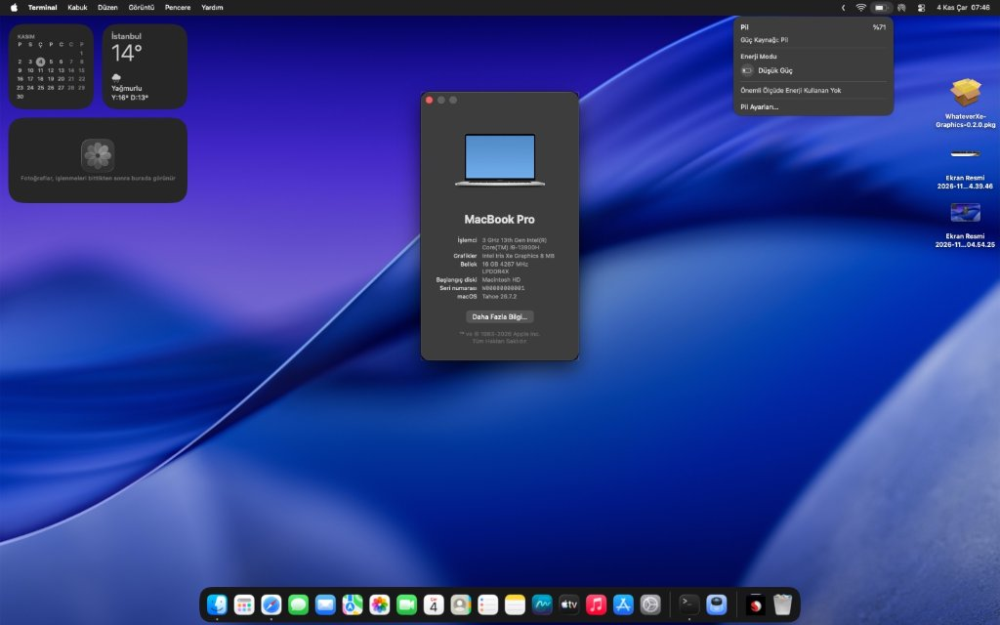

# 🍎 Huawei MateBook D 16 (2023/2024) Hackintosh Rehberi

<p align="center">
  
</p>

<p align="center">
  <a href="README.md"></a>
  
  
  
  
</p>

---

> 📖 **Dil Seçimi:**
> - 🇹🇷 **Türkçe:** [README_TR.md](README_TR.md) *(Buradasınız)*
> - 🇬🇧 **English:** [README.md](README.md)

---

## 📌 Proje Hakkında ve Giriş

Bu depo, **Huawei MateBook D 16 (2023 / 2024 - Intel Core i9-13900H Raptor Lake)** dizüstü bilgisayarına **macOS Sonoma, Sequoia ve Tahoe** kurulumu yapmak isteyenler için hazırlanmış en kapsamlı Türkçe açık kaynak Hackintosh rehberidir.

Intel 12. ve 13. Nesil hibrit (P-Core + E-Core) işlemciler Apple tarafından hiçbir zaman resmi Mac modellerinde kullanılmadığı için bu donanımlarda Hackintosh kurulumu özel ACPI yamaları, zamanlayıcı düzeltmeleri ve sürücü düzenlemeleri gerektirir. Bu rehberde, kurulum boyunca edindiğimiz tecrübeleri, çalışan donanımları, henüz geliştirme aşamasındaki bileşenleri ve çözüm adımlarını bulabilirsiniz.

---

## 💻 Donanım Özellikleri ve Uyumluluk Tablosu

| Bileşen | Donanım Bilgisi | macOS Durumu | Açıklama & Notlar |
| :--- | :--- | :---: | :--- |
| **Model** | Huawei MateBook D 16 (2023/2024, MCLG-XX) | 🟢 | UEFI OpenCore tam uyumlu yapılandırma |
| **İşlemci (CPU)** | Intel® Core™ i9-13900H (14 Çekirdek / 20 İzlek: 6P + 8E) | 🟢 **Çalışıyor** | `CpuTopologyRebuild.kext` ile hibrit çekirdek zamanlaması tam performans |
| **Dahili Grafik (iGPU)** | Intel® Iris® Xe Graphics 96EU (`8086:A7A0`) | 🟡 **Temel Görüntü** | 1920x1200 yerel çözünürlük; 3D/Metal hızlandırma WhateverXe'nin yeni sürümünü bekliyor |
| **Bellek (RAM)** | 16 GB LPDDR4X 4267 MHz (Çift Kanal) | 🟢 **Çalışıyor** | Sorunsuz algılanıyor, bellek sızıntısı yok |
| **Depolama** | 1 TB M.2 PCIe 4.0 NVMe SSD | 🟢 **Çalışıyor** | `NVMeFix.kext` ile APFS dosya sistemi tam hızda |
| **Kablosuz Ağ (Wi-Fi)** | Intel® Wi-Fi 6 AX201 160MHz (`8086:51F1`) | 🟢 **Çalışıyor** | `AirportItlwm.kext` ile yerel macOS Wi-Fi menüsü |
| **Bluetooth** | Intel® Wireless Bluetooth (`8087:0026`) | 🟡 **Geliştiriliyor** | Aygıt algılanıyor ancak açıldığında hemen geri kapanma sorunu mevcut; sonraki commit'lerde düzeltilecek |
| **Batarya** | 70,000 mWh ACPI Batarya (`ACPI\PNP0C0A`) | 🟢 **Çalışıyor** | `ECEnabler.kext` ile pil yüzdesi ve şarj durumu menü çubuğunda |
| **Klavye** | Dahili PS/2 Klavye ve Aydınlatma | 🟢 **Çalışıyor** | `VoodooPS2Controller.kext` ile tam işlevsel |
| **Parlaklık Tuşları** | F1 / F2 Ekran Parlaklık Kısayolları | 🟢 **Çalışıyor** | `BrightnessKeys.kext` ile yerel macOS parlaklık animasyonu |
| **Touchpad** | FocalTech FTCS1000 I2C Hassas Dokunmatik Yüzey | 🟡 **Geliştiriliyor** | Özel derlenmiş `SSDT-TPD0.aml` ile `_SB.PC00.I2C0` altına köprülendi |
| **Ses Kartı** | Conexant CX8200 / SN6140 (`14F1:1F87`) Intel cAVS (`8086:51CA`) | 🟡 **Test Ediliyor** | AppleALC Layout-ID testleri sürüyor |
| **Giriş/Çıkış Portları** | Type-C (Güç + Veri), USB 3.2, USB 2.0, HDMI | 🟢 **Çalışıyor** | `USBToolBox.kext` ile haritalandırıldı |

---

## 🎯 Donanım Durumu ve Önemli Ayrıntılar

### ⚡ Sorunsuz Çalışanlar:
- ✅ **Intel Core i9 Hibrit Çekirdek Gücü:** `CpuTopologyRebuild.kext` sayesinde macOS 6 P-çekirdeği ve 8 E-çekirdeği doğru algılar; takılma veya gecikme olmadan sistem çok seri çalışır.
- ✅ **Doğru İşlemci İsmi Görünümü:** "Bu Mac Hakkında" ekranında işlemci adı `3 GHz 13th Gen Intel(R) Core(TM) i9-13900H` olarak kusursuz görünür (`RestrictEvents.kext` + `revcpu=1`).
- ✅ **Batarya Göstergesi:** `ECEnabler.kext` katıştırılmış denetleyiciyi (EC) doğrudan bağlar; pil simgesi ve şarj durumu stabil çalışır.
- ✅ **Wi-Fi 6 AX201:** `AirportItlwm.kext` ile internete sorunsuz bağlantı, yüksek hız ve yerel macOS menü çubuğu entegrasyonu.
- ✅ **Yüksek Hızlı PCIe 4.0 NVMe:** APFS dosya sistemi ile tam uyumlu ve hızlı açılış.
- ✅ **Yerel Çözünürlük ve Ekran Parlaklığı:** 1920x1200 yerel panel çözünürlüğü ve klavyeden parlaklık kontrolü.
- ✅ **Çift İşletim Sistemi (Dual Boot):** Windows 11 ve macOS birbirine zarar vermeden aynı NVMe üzerinde barınır.

### 🟡 Bilinen Durumlar ve Geliştirme Süreci (Açık ve Şeffaf):
1. **Intel Iris Xe Grafik Hızlandırma:**
   - Ekran VESA / Framebuffer modunda 1920x1200 çözünürlükle akıcı olarak çalışır.
   - WhateverXe geliştiricileri şu an Tiger Lake (11. Nesil) desteğini tamamlamış olup, Alder Lake ve Raptor Lake (12./13. Nesil) desteği üzerinde çalışmaktadır.
   - Yaptığımız ikili tersine mühendislik analizinde Metal 3D kütüphanelerinin başarıyla bağlandığı doğrulanmış, ancak eDP dahili panel sinyal kayıtlarının resmi WhateverXe güncellemesiyle eşleşmesi beklenmektedir. *Yeni sürüm çıktığında EFI'ye doğrudan sürücü eklenerek donanım hızlandırma açılacaktır.*
2. **FocalTech FTCS1000 Touchpad:**
   - Huawei'nin fabrika ACPI tablosunda Touchpad aygıtı (`TPD0`), I2C kontrolcüsünün (`_SB.PC00.I2C0`) altına değil, yanlışlıkla doğrudan anakart köküne konulmuştur.
   - Bu nedenle `VoodooI2C` sürücüsü aygıtı göremiyordu. Yazdığımız `SSDT-TPD0.aml` tablosu ile aygıt doğru veriyoluna taşınmış ve orijinal aygıt susturulmuştur. İlerleyen güncellemelerde GPIO kesmesi tam optimize edilecektir.
3. **Dahili Hoparlör / Mikrofon:**
   - Conexant CX8200 yongasının macOS AppleALC layout kimlikleri (Layout 3, 11, 21, 28) test edilmektedir.
4. **Bluetooth Açılıp Kapanma Sorunu:**
   - Intel Bluetooth modülü sistem tarafından tanınmaktadır (`IntelBluetoothFirmware.kext` + `BlueToolFixup.kext`).
   - Ancak Ayarlar veya Denetim Merkezi'nden Bluetooth anahtarı açılmak istendiğinde açılıp birkaç saniye içinde kendiliğinden geri kapanmaktadır.
   - Bu durum modern macOS (Sonoma/Sequoia/Tahoe) Bluetooth yığınında firmware yükleme zamanlaması veya USB port dahili eşitlemesinden kaynaklanmaktadır; ilerleyen commit'lerde düzenlenecektir.

---

## 🔧 BIOS Ayarları

macOS yükleyicisini başlatmadan önce Huawei BIOS ekranına (**açılışta F2**) girerek şu ayarları yapın:

| BIOS Ayarı | Olması Gereken | Açıklama |
| :--- | :--- | :--- |
| **Secure Boot** | **Disabled (Kapalı)** | İmzalanmamış OpenCore sürücülerinin yüklenmesi için zorunlu |
| **Fast Boot** | **Disabled (Kapalı)** | Donanım kontrolcülerinin temiz başlaması için |
| **Intel Virtualization (VT-x)** | **Enabled (Açık)** | Çekirdek ve sanallaştırma desteği için |
| **Intel VT-d** | **Enabled (Açık)** | `DisableIoMapper = False` ile desteklenir |
| **SATA / NVMe Modu** | **AHCI / Standart NVMe** | Intel RST RAID modu kapalı olmalıdır |

---

## 🚀 Kurulum Rehberi

### 1. USB Kurulum Belleğinin Hazırlanması
1. **macrecovery** veya **gibMacOS** kullanarak macOS Sonoma (14.x), Sequoia (15.x) veya Tahoe yükleyicisini indirin.
2. USB belleğinizi `GUID Bölüntü Tablosu (GPT)` düzeninde biçimlendirin.

### 2. EFI Klasörünün Kopyalanması
1. Bu depoyu indirin veya klonlayın:
   ```bash
   git clone https://github.com/akiffurkan/Huawei-MateBook-D16-Hackintosh-Guide.git
   ```
2. Depo içindeki `EFI` klasörünü USB belleğinizin EFI bölümüne doğrudan kopyalayın.

### 3. Kendi Seri Numaranızı Üretme (Çok Önemli!)
> [!IMPORTANT]
> Depo içerisindeki `config.plist` dosyasında gizlilik amacıyla geçici sahte seri numaraları (`C02XXXXXXXXX`) bulunmaktadır. Kendi Apple ID ve iCloud hesabınızla sorunsuz giriş yapmak için kendi seri numaranızı üretmelisiniz:

1. [GenSMBIOS](https://github.com/corpnewt/GenSMBIOS) aracını indirin.
2. GenSMBIOS'u çalıştırıp `3` (Generate SMBIOS) seçeneğini seçin.
3. Model adı olarak `MacBookPro16,1` girin.
4. Çıkan `Type`, `Serial`, `Board Serial (MLB)` ve `SmUUID` değerlerini `EFI/OC/config.plist` içindeki `PlatformInfo -> Generic` altına yazın.

### 4. Kurulum ve Başlatma
1. USB belleği bilgisayara takın ve açılırken **F12** tuşuna basarak Boot menüsüne girin.
2. OpenCore UEFI girdisini seçin.
3. OpenCore ekranı geldiğinde **ilk açılışta mutlaka Reset NVRAM** seçeneğini çalıştırın!
4. Ardından **Install macOS** seçeneği ile disk izlencesinden NVMe üzerinde ayırdığınız APFS alanına kurulumu tamamlayın.

---

## 💡 Önemli Teknik Püf Noktaları

### Neden "Bu Mac Hakkında" Ekranında 5.40 GHz Yerine 3.00 GHz Yazıyor?
macOS, işlemcilerin Turbo tavan frekansını değil, **Temel Saat Hızını (Base Clock)** gösterir. Core i9-13900H işlemcinin temel frekansı fabrika çıkışı tam **3.00 GHz**'dir. Orijinal MacBook Pro'larda da bu şekilde temel hız yazar, ancak işlemci yüke girdiği anda `CpuTopologyRebuild` ve güç yönetimi sayesinde çekirdekler otomatik olarak **5.40 GHz**'e fırlar! Yani bir performans kaybı yoktur.

### Batarya Kalibrasyon Notu (70,000 mWh)
MacBook Pro'ların bataryaları varsayılan olarak ~60,000 mAh civarındadır. MateBook D16 bataryası ise 70,000 mWh kapasiteye sahip olduğu için pil şarjı 60,000 seviyesinin altına inene kadar macOS pil göstergesi %100 göstermeye devam eder. Bu seviyenin altına indiğinde yüzde normal seyrinde düşer.

---

## 🗺️ Yol Haritası ve İlerleyen Commitler

- [x] Intel hibrit çekirdek kontrolü (`CpuTopologyRebuild`)
- [x] OpenCore 1.0.4+ UEFI altyapısı ve ACPI tabloları
- [x] Kozmetik işlemci adı enjeksiyonu (`RestrictEvents` + `revcpu`)
- [x] Batarya durum göstergesi (`ECEnabler`)
- [x] FocalTech Dokunmatik Yüzey için özel ACPI köprüsü (`SSDT-TPD0.aml`)
- [ ] FocalTech FTCS1000 GPIO kesme pininin tam haritalanması
- [ ] Conexant CX8200 için en uygun AppleALC Layout-ID'nin netleştirilmesi
- [ ] WhateverXe ekibi resmi ADL/RPL hızlandırmasını yayınladığında EFI'ye tek tıkla entegre edilmesi

---

## 🤝 Katkıda Bulunma

Aynı model Huawei MateBook D 16'ya sahipseniz veya ACPI/sürücü konusunda katkı sunmak isterseniz bir Issue veya Pull Request açmaktan çekinmeyin!

---

## 📜 Teşekkürler

- [Acidanthera](https://github.com/acidanthera) ekibine (OpenCore, Lilu, VirtualSMC, AppleALC, RestrictEvents).
- [Alexandred](https://github.com/VoodooI2C/VoodooI2C) ekibine (VoodooI2C ve VoodooI2CHID).
- [b00t0x](https://github.com/b00t0x) geliştiricisine (`CpuTopologyRebuild`).
- [1Revenger1](https://github.com/1Revenger1) & [ChefKissInc](https://github.com/ChefKissInc) geliştiricilerine (`ECEnabler`, `WhateverXe`).
- [OpenIntelWireless](https://github.com/OpenIntelWireless) ekibine (`AirportItlwm`, `IntelBluetoothFirmware`).

---

<p align="center">
  Geliştirici: <a href="https://github.com/akiffurkan">Akif Furkan EMİR</a>
</p>
